* content
{:toc}

前排感谢：

- [**给世界上色——滤镜底层原理**](https://blog.csdn.net/q345911572/article/details/119351319)
- [**图像处理的滤镜算法**](https://juejin.cn/post/6844903680244711431)
- [**JH LABS Java Image Processing**](http://www.jhlabs.com/ip/filters/)
- [**3D LUT 图**](https://github.com/positlabs/spark-lut-patch#included-luts)

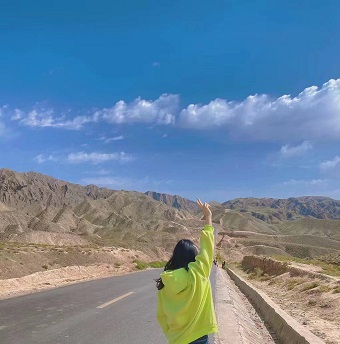

## **一、LUT（Look Up Table）**

&emsp;&emsp;LUT 图采用 **`64`** 个 **`64`** * **`64`** 像素的格子组成的 512 * 512 像素的图片，每个像素上的 RGB 值则是对应原始图片 RGB 的一个映射；因此对于 LUT 图，需要确认的是如何通过原始图片的 RGB 值找到对应 LUT 上某个像素的 RGB 值。 

&emsp;&emsp;LUT 图按照从左往右、从上到下将 64 个格子标记为 **0~63**，根据原始图像的 Blue 值计算出格子数（gridNum = blueValue / 4）以确定映射值在哪个格子中；再根据原始图像的 Red 值计算在该格子中的 x 像素（pixelX = red / 4）；原始图像的 Green 值计算出在该格子中的 y 像素（pixelY = green / 4）。那么为什么是除以 4；原因在于 RGB 的取值有 `256` * `256` * `256` 种，而为了减少存储的空间，LUT 图设计成 `64` * `64` * `64`；及 R、G、B 上 4 个连续的值对应 LUT 上的同一个映射值。

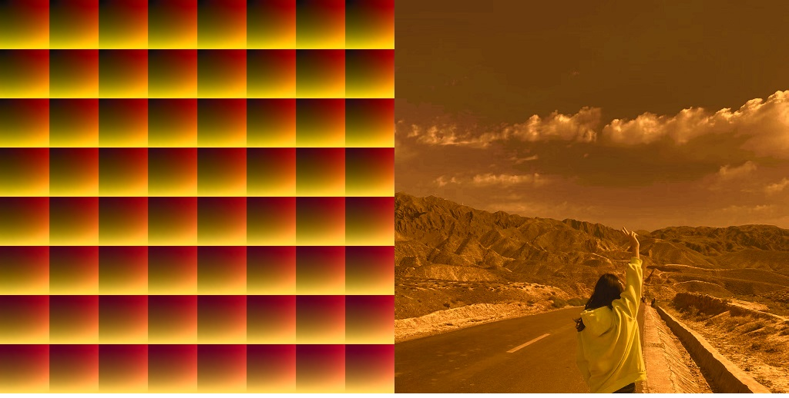

&emsp;&emsp;转换的工具类如下，其中 **`filterImage()`** 方法用于给图片文件转换调用，而 **`convertImageFilter()`** 可用于提供给 JavaCV 处理视频的图像帧时调用；其中参数 **`filterImage`** 为对应的 **`LUT`** 文件。

~~~java
import javax.imageio.ImageIO;
import java.awt.*;
import java.awt.image.BufferedImage;
import java.io.File;
import java.io.FileNotFoundException;
import java.io.IOException;

public class FilterImage {

    public static void filterImage(String inputImage, String outputImage, String filterImage) throws IOException {
        File inputFile = new File(inputImage);
        File filterFile = new File(filterImage);
        if (!inputFile.exists() || !inputFile.isFile() || !filterFile.exists() || !filterFile.isFile()) {
            throw new FileNotFoundException();
        }
        BufferedImage bufferedImage = ImageIO.read(inputFile);
        BufferedImage bufferedImageFilter = ImageIO.read(filterFile);
        BufferedImage newImage;
        newImage = convertImageFilter(bufferedImage, bufferedImageFilter);
        String imageFormat = outputImage.substring(outputImage.lastIndexOf(".") + 1);
        File outputFile = new File(outputImage);
        ImageIO.write(newImage, imageFormat, outputFile);
    }

    public static BufferedImage convertImageFilter(BufferedImage bufferedImage, BufferedImage bufferedImageFilter) {
        BufferedImage newImage = new BufferedImage(bufferedImage.getWidth(), bufferedImage.getHeight(), bufferedImage.getType());
        Graphics graphics = newImage.createGraphics();
        for (int x = 0; x < bufferedImage.getWidth(); x++) {
            for (int y = 0; y < bufferedImage.getHeight(); y++) {
                Color oldColor = new Color(bufferedImage.getRGB(x, y));
                int oldRed = oldColor.getRed();
                int oldGreen = oldColor.getGreen();
                int oldBlue = oldColor.getBlue();

                int gridNum = oldBlue / 4;
                int newX = gridNum / 8 * 64 + oldRed / 4;
                int newY = gridNum / 8 * 64 + oldGreen / 4;
                newImage.setRGB(x, y, bufferedImageFilter.getRGB(newX, newY));
            }
        }
        graphics.dispose();
        return newImage;
    }

}

~~~

 

## **二、常见的滤镜算法**

&emsp;&emsp;首先写一个滤镜算法转换的工具类，其中 **`filterImage()`** 方法用于给图片文件转换调用，而 **`convertImageFilter()`** 可用于提供给 JavaCV 处理视频的图像帧时调用；其中参数 **`IFilterImage`** 为定义的常见滤镜算法的接口规范；通过 **`convertImageRGB()`** 方法将当前像素的 **RGB** 值转换成对应滤镜的 **RGB** 值，以完成滤镜效果。

~~~java
import javax.imageio.ImageIO;
import java.awt.image.BufferedImage;
import java.io.File;
import java.io.FileNotFoundException;
import java.io.IOException;

public class FilterImage {

    public static void filterImage(String inputImage, String outputImage, IFilterImage filterImage) throws IOException {
        File inputFile = new File(inputImage);
        if (!inputFile.exists() || !inputFile.isFile()) {
            throw new FileNotFoundException();
        }
        BufferedImage bufferedImage = ImageIO.read(inputFile);
        BufferedImage newImage = filterImage.convertImage(bufferedImage);
        String imageFormat = outputImage.substring(outputImage.lastIndexOf(".") + 1);
        File outputFile = new File(outputImage);
        ImageIO.write(newImage, imageFormat, outputFile);
    }

}

import java.awt.image.BufferedImage;

public abstract class AbsFilterImage {

    public BufferedImage convertImage(BufferedImage bufferedImage) {
        BufferedImage newImage = new BufferedImage(bufferedImage.getWidth(), bufferedImage.getHeight(), bufferedImage.getType());
        for (int x = 0; x < bufferedImage.getWidth(); x++) {
            for (int y = 0; y < bufferedImage.getHeight(); y++) {
                newImage.setRGB(x, y, convertImageRGB(bufferedImage.getRGB(x, y)));
            }
        }
        return newImage;
    }

    protected int convertImageRGB(int oldRGB) {
        return oldRGB;
    }

}
~~~

#### &emsp;**1、灰度滤镜**

&emsp;&emsp;将 RGB 设置为相同的值即可使得图片为灰色，而计算灰度值通常有三种方式：`1`. 取三种颜色的**平均值**；`2`. 取三种颜色的**最大值**/**最小值**；`3`. **加权平均值**（0.299 * R + 0.587 * G + 0.114 * B）

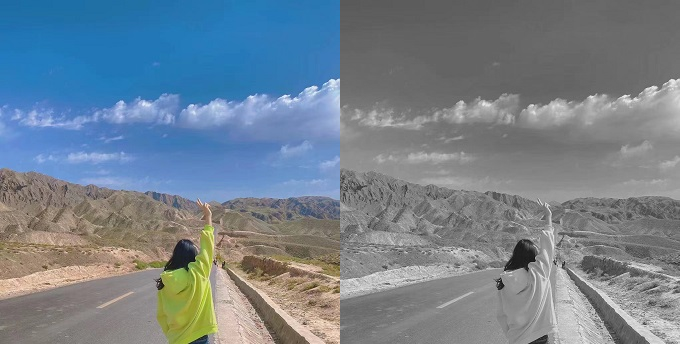

~~~java
import java.awt.*;

public class GrayScaleFilterImage extends AbsFilterImage {

    public static final byte AVERAGE = 0;
    public static final byte MAX = 1;
    public static final byte MIN = 2;
    public static final byte WEIGHT = 3;

    private final byte type;

    /**
     * @param type {@code AVERAGE} 取三种颜色的平均值; {@code MAX} 取三种颜色的最大值;
     * {@code MIN 取三种颜色的最小值; {@code WEIGHT} 计算三种颜色的加权平均值;
     */
    public GrayScaleFilterImage(byte type) {
        this.type = type;
    }

    @Override
    public int convertImageRGB(int oldRGB) {
        Color color = new Color(oldRGB);
        int red = color.getRed();
        int green = color.getGreen();
        int blue = color.getBlue();
        int gray;
        switch (type) {
            case AVERAGE:
                gray = (red + green + blue) / 3;
                break;
            case MAX:
                gray = Math.max(red, Math.max(green, blue));
                break;
            case MIN:
                gray = Math.min(red, Math.min(green, blue));
                break;
            case WEIGHT:
            default:
                gray = (int) (0.299F * red + 0.587F * green + 0.114F * blue);
                break;
        }
        return new Color(gray, gray, gray).getRGB();
    }

}
~~~

#### &emsp;**2、黑白滤镜**

&emsp;&emsp;图片的颜色只有黑色和白色，可以计算 RGB 的平均值 average，average >= 100，r=g=b=255，否则为 0

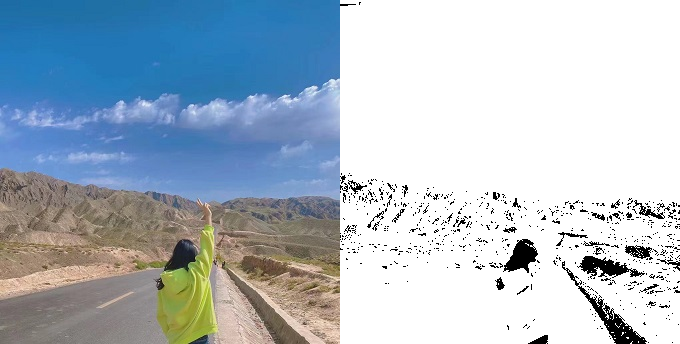

~~~java
import java.awt.*;

public class BlackWhiteFilterImage extends AbsFilterImage {

    @Override
    public int convertImageRGB(int oldRGB) {
        Color color = new Color(oldRGB);
        int red = color.getRed();
        int green = color.getGreen();
        int blue = color.getBlue();
        int average = (red + green + blue) / 3;
        int temp = average >= 100 ? 255 : 0;
        return new Color(temp, temp, temp).getRGB();
    }

}
~~~

#### &emsp;**3、去色滤镜**

&emsp;&emsp;获取 RGB 颜色的 **`最大值`** 和 **`最小值`** 求其 **`平均值`**

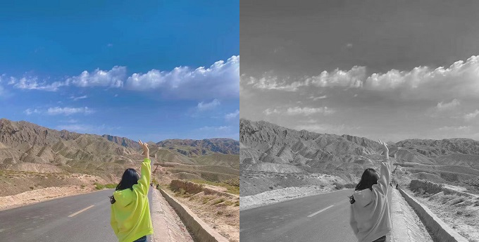

~~~java
import java.awt.*;

public class DigitalColorFilterImage extends AbsFilterImage {

    @Override
    public int convertImageRGB(int oldRGB) {
        Color color = new Color(oldRGB);
        int red = color.getRed();
        int green = color.getGreen();
        int blue = color.getBlue();
        int max = Math.max(red, Math.max(green, blue));
        int min = Math.min(red, Math.min(green, blue));
        int average = (max + min) / 2;
        return new Color(average, average, average).getRGB();
    }

}
~~~

#### &emsp;**4、反向（底片）滤镜**

&emsp;&emsp;RGB 三种颜色分别取 255 的差值

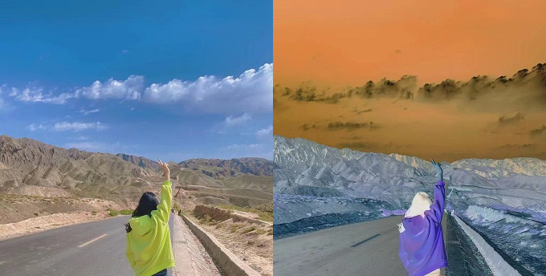

~~~java
import java.awt.*;

public class ReverseFilterImage extends AbsFilterImage {

    @Override
    public int convertImageRGB(int oldRGB) {
        Color color = new Color(oldRGB);
        int red = 255 - color.getRed();
        int green = 255 - color.getGreen();
        int blue = 255 - color.getBlue();
        return new Color(red, green, blue).getRGB();
    }

}
~~~

#### &emsp;**5、单色滤镜**

&emsp;&emsp;仅保留 RGB 中的一种颜色

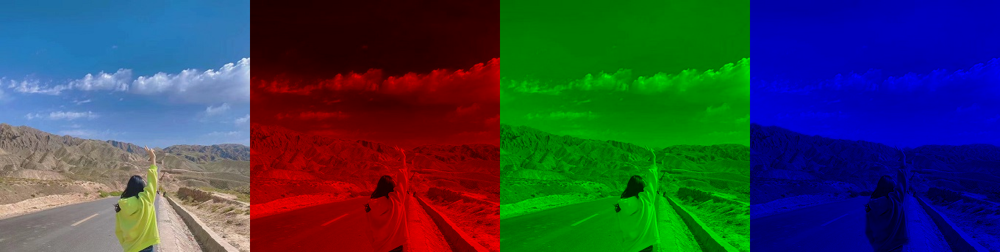

~~~java
import java.awt.*;

public class SingleColorFilterImage extends AbsFilterImage {

    private final SingleColor singleColor;

    public SingleColorFilterImage(SingleColor singleColor) {
        this.singleColor = singleColor;
    }

    @Override
    public int convertImageRGB(int oldRGB) {
        Color color = new Color(oldRGB);
        int red = color.getRed();
        int green = color.getGreen();
        int blue = color.getBlue();
        switch (singleColor) {
            case RED:
                green = 0; blue = 0;
                break;
            case GREEN:
                red = 0; blue = 0;
                break;
            case BLUE:
                red = 0; green = 0;
                break;
        }
        return new Color(red, green, blue).getRGB();
    }

    public enum SingleColor {
        RED, GREEN, BLUE;
    }

}
~~~

#### &emsp;**6、怀旧（褐色）滤镜**

- R = 0.393 * r + 0.769 * g + 0.189 * b
- G = 0.349 * r + 0.686 * g + 0.168 * b
- B = 0.272 * r + 0.534 * g + 0.131 * b

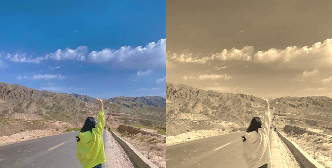

~~~java
import java.awt.*;

public class NostalgiaFilterImage extends AbsFilterImage {

    @Override
    public int convertImageRGB(int oldRGB) {
        Color color = new Color(oldRGB);
        int red = (int) (0.393F * color.getRed() + 0.796F * color.getGreen() + 0.189F * color.getBlue());
        int green = (int) (0.349F * color.getRed() + 0.686F * color.getGreen() + 0.168F * color.getBlue());
        int blue = (int) (0.272F * color.getRed() + 0.534F * color.getGreen() + 0.131F * color.getBlue());
        red = Math.max(0, Math.min(red, 255));
        green = Math.max(0, Math.min(green, 255));
        blue = Math.max(0, Math.min(blue, 255));
        return new Color(red, green, blue).getRGB();
    }

}
~~~

#### &emsp;**7、连环画滤镜**

 *  R = |2g - b + r| * r / 256
 *  G = |2b - g + r| * r / 256
 *  B = |2b - g + r| * g / 256

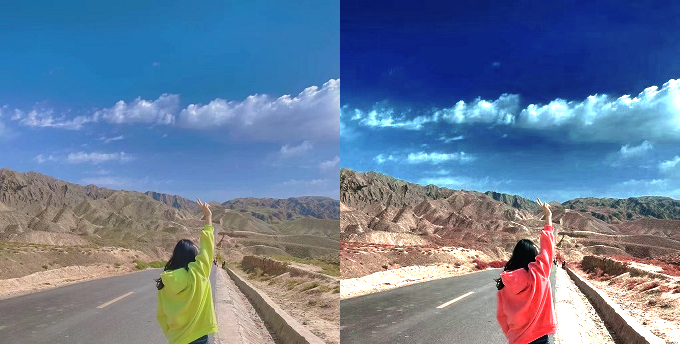

~~~java
import java.awt.*;

public class ComicFilterImage extends AbsFilterImage {

    @Override
    public int convertImageRGB(int oldRGB) {
        Color color = new Color(oldRGB);
        int red = Math.abs((2 * color.getGreen() - color.getBlue() + color.getRed()) * color.getRed() / 256);
        int green = Math.abs((2 * color.getBlue() - color.getGreen() + color.getRed()) * color.getRed() / 256);
        int blue = Math.abs((2 * color.getBlue() - color.getGreen() + color.getRed()) * color.getGreen() / 256);
        red = Math.min(red, 255);
        green = Math.min(green, 255);
        blue = Math.min(blue, 255);
        return new Color(red, green, blue).getRGB();
    }

}
~~~

#### &emsp;**8、曝光滤镜**

&emsp;&emsp;调整图像的曝光度，曝光度默认 1.0；可取值范围 [0.0, 5.0]

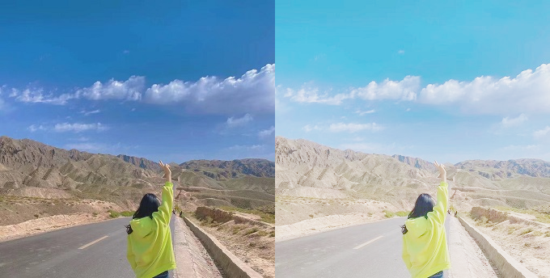

~~~java
import java.awt.*;

public class ExposureFilterImage extends AbsFilterImage {

    private final float exposure;

    public ExposureFilterImage(float exposure) {
        this.exposure = Math.max(0F, Math.min(exposure, 5F));
    }

    private int getNewRGB(int value) {
        int rgb = (int) (255 * (1 - Math.exp(-value * exposure / 255)));
        return Math.max(0, Math.min(rgb, 255));
    }

    @Override
    protected int convertImageRGB(int oldRGB) {
        Color color = new Color(oldRGB);
        int red = getNewRGB(color.getRed());
        int green = getNewRGB(color.getGreen());
        int blue = getNewRGB(color.getBlue());
        return new Color(red, green, blue).getRGB();
    }

}
~~~

#### &emsp;**9、增益滤镜**

&emsp;&emsp;该滤镜改变图像的对比度。更准确地说，它允许您更改图像中颜色的 增益和偏差。更改偏差会使颜色偏向更亮或更暗。改变增益会改变对比度。

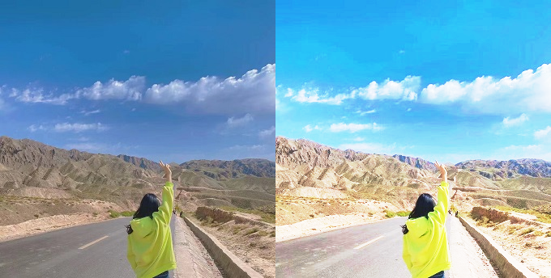

~~~java
import java.awt.*;

public class GainFilterImage extends AbsFilterImage {

    public static final float DEFAULT_GAIN = 0.5F;
    public static final float DEFAULT_BIAS = 0.5F;

    /**
     * [0.0 - 1.0] 0.5 不发送改变，小于 0.5 减少增益、大于 0.5 增加增益值
     */
    private float gain = DEFAULT_GAIN;

    /**
     * [0.0 - 1.0] 0.5 不发送改变，小于 0.5 趋向于更暗、大于 0.5 趋向于更亮
     */
    private float bias = DEFAULT_BIAS;

    public GainFilterImage() {
    }

    public GainFilterImage(float gain, float bias) {
        this.gain = Math.max(0F, Math.min(gain, 1F));
        this.bias = Math.max(0F, Math.min(bias, 1F));
    }

    private int getNewRGB(int value) {
        float coefficient = getGainValue(value / 255F, gain);
        int rgb = (int) (255 * getBiasValue(coefficient, bias));
        return Math.max(0, Math.min(rgb, 255));
    }

    private float getGainValue(float a, float b) {
        float c = (1.0F / b - 2.0F) * (1.0F - 2.0F * a);
        if (a < 0.5)
            return a / (c + 1.0F);
        else
            return (c - a) / (c - 1.0F);
    }

    private float getBiasValue(float a, float b) {
        return a / ((1.0F / b - 2) * (1.0F - a) + 1);
    }

    @Override
    protected int convertImageRGB(int oldRGB) {
        Color color = new Color(oldRGB);
        int red = getNewRGB(color.getRed());
        int green = getNewRGB(color.getGreen());
        int blue = getNewRGB(color.getBlue());
        return new Color(red, green, blue).getRGB();
    }

}
~~~

#### &emsp;**10、日晒滤镜**

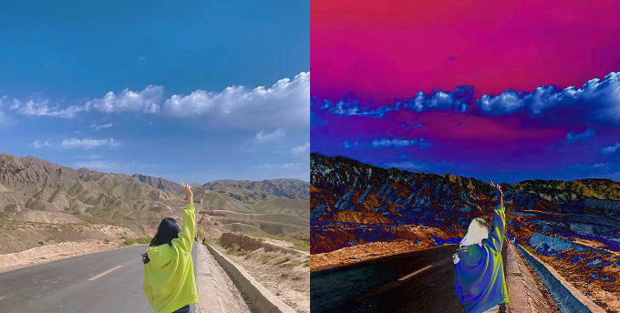

~~~java
import java.awt.*;

public class SolarizeFilterImage extends AbsFilterImage {

    @Override
    protected int convertImageRGB(int oldRGB) {
        Color color = new Color(oldRGB);
        int red = Math.abs(2 * color.getRed() - 255);
        int green = Math.abs(2 * color.getGreen() - 255);
        int blue = Math.abs(2 * color.getBlue() - 255);
        return new Color(red, green, blue).getRGB();
    }

}
~~~

***...***